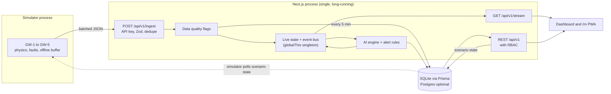

# DOCTOR PV — Build Plan

Status: **confirmed, with scope reduced for the 7 November 2026 pitch.** Indonesian only. PDF/Excel, user and settings CRUD, PWA, English, Postgres, the LLM assistant and the full kanban are cut. Some sizing below changed during the build, such as batteries now being 10.24 kWh. See README.md for the current state.
Checked on 2026-11-04 against the npm registry and this machine.

---

## 1. Decisions needed before Phase 1

Each has a default, so "go" accepts all of them.

| # | Decision | Default | Why it matters |
|---|---|---|---|
| D1 | Where does the git repo live? | Run `git init` inside `Documents/hackton` | The enclosing repo is rooted at your **home directory** and has unrelated changes from `della-muda` and `learntrack2`. A commit from here could land in that repo. |
| D2 | Node version | Install Node 24 LTS with nvm and pin it in `.nvmrc` | You have 25.9 (system) and 20.20 (nvm). Vitest 5 excludes 25 (`^22.12 \|\| ^24 \|\| >=26`) and better-sqlite3 13 needs ≥22, so neither works. |
| D3 | Real RT location | Placeholder coordinates, set through env | Generated houses won't line up with real streets at any location. See risk R3. |
| D4 | Hackathon deadline | Build all 5 phases in order | If time is short, use the cut line in §9. |
| D5 | Demo environment | Local production build on a laptop | The design needs one long-running Node process, so it won't work on serverless as specified. See §2. |

---

## 2. Changes to the spec (rule 6)

### Technically unrealistic as written

| Spec says | Problem | Proposal |
|---|---|---|
| Switch SQLite → Postgres "by changing one env var" | Prisma's `provider` must be a literal in the schema, not `env()`. Prisma 7 also needs a different driver adapter per database. | `DATABASE_PROVIDER` env plus `scripts/prisma-select.ts`, which generates the schema for that provider and selects the adapter. `npm run db:setup` runs it, so it is one env var plus one command. Postgres is smoke-tested once in Phase 5. |
| `gangIds` on `User` | SQLite has no array columns. | `UserGang` join table. |
| One `SolarTelemetry` table holding both hourly and 5-minute data | The two resolutions would mix and double-count. | Add a `resolution` column (`5m`, `1h`) and a unique index on `(assetId, resolution, time)`. |
| One POST per device | 150+ devices at a 5 s tick is 30+ HTTP requests per second on an 8 GB laptop. | `/ingest` accepts an **array** of contract-compliant messages, so each gateway sends 1 POST per tick. The per-device topic and JSON contract are unchanged. |
| Battery charge/discharge on a per-house meter | Batteries are shared per gang, so a house has no battery flow of its own. | Battery fields apply only at gang and RT scope. See §5. |
| PWA on a technician's phone | Service workers need HTTPS or localhost, so a phone on `http://192.168.x.x` can't install it. | Run the phone demo through an HTTPS tunnel or local certificate, or show mobile view in browser device emulation. Covered in `demo-script.md`. |
| SoH range 72–99% with 80% end of life | Batteries under 80% would get a negative remaining life. | Show "Past end-of-life threshold, replacement recommended" with no life estimate. |

### Phase ordering conflicts

| Conflict | Resolution |
|---|---|
| Phase 3 pages need health scores, alerts and priorities, but the AI engine arrives in Phase 4. | Move the health score and a threshold-based alert engine to **Phase 2**. Until Phase 4, "Top priorities" uses rule-based ranking. Phase 4 then adds anomaly detection, root cause analysis and forecasting. |
| Phase 1 must show the role-correct menus, but "no placeholder screens" is non-negotiable. | Between phases, unbuilt routes show a titled skeleton so navigation and RBAC can be tested. The rule applies in full at the end of Phase 5. |
| Admin and technician views are needed side by side, but one browser holds one session cookie. | Use a second browser profile or a phone. Covered in `demo-script.md`. |

### Library choices that differ from a plain `npm install`

| Library | Registry state | Choice |
|---|---|---|
| Prisma | `latest` points to **`8.0.0-rc.30`, a release candidate** | Pin **7.10.1** with `@prisma/adapter-better-sqlite3`. |
| Auth.js | `next-auth` stable is 4.24.15 and v5 is still beta | Use **4.24.15** (rule 4: stable). It supports Next 16. JWT session with role and gang scope. |
| Animation | `framer-motion` and `motion` are both 14.9.1 | Use `motion`, the current package name. |
| PWA | `@serwist/next` adds a CLI and build step | Hand-written `sw.js` and manifest. It never caches authenticated API responses. |
| TanStack Table | v9 is a new major version | Check the installed API before building `DataTable`. |

**Additions to the stack:** `cmdk` (command palette), `@dnd-kit/core` (kanban), `@resvg/resvg-js` (server-side charts to PNG for PDFs).

Other versions: Next 16.4.5, React 19.3.1, Tailwind 4.3.4, ECharts 6.1.0, echarts-for-react 3.0.6, MapLibre 6.16.0, react-map-gl 8.1.3, Zod 4.6.7, next-intl 4.14.9, TanStack Query 5.105.3, Zustand 5.0.16, exceljs 4.4.0, @react-pdf/renderer 4.9.0, Vitest 5.1.0.

### Assumptions to check before the pitch

- **PLN export credit:** my understanding is that Permen ESDM 2/2024 ended export credit for rooftop PV. The default is therefore **no credited export**: surplus PV is shown as curtailed and earns no savings. An `exportCreditEnabled` setting can change this. Please check the regulation.
- **Shared gang storage:** one battery bank serving 20 houses implies a shared gang-level bus, which may have regulatory and metering implications. Judges may ask about this.
- **Tariff and emission factor:** both are configurable and labeled as estimates. Confirm the default values against a citable source before presenting them.

---

## 3. Architecture



Key design choices:

- **One long-running process.** SSE and live state are in memory. A `globalThis` singleton survives Next's module reloads. This can't run on SQLite with serverless instances, so a real multi-instance deployment would need Postgres and a broker such as Redis or MQTT. `docs/architecture.md` will explain this.
- **Live and stored data are separate.** Each 5 s tick updates memory and SSE. Only 5-minute boundaries are written to the database.
- **Scenarios reach the simulator through shared state.** The API writes the active scenario and the simulator picks it up within 1 tick. Faults therefore travel the same ingest → detect → alert path as real data, not a shortcut.
- **Virtual clock.** All time comes from one `simClock`. See risk R1.

---

## 4. Project structure

The project lives directly in `Documents/hackton` (the spec's `doctor-pv/`).

```
prisma/        schema.template.prisma, seed.ts
simulator/     index.ts, physics.ts, scenarios.ts, geo.ts, clock.ts
scripts/       prisma-select.ts, demo.ts
src/app/
  (auth)/login
  (app)/       dashboard, map, solar, batteries, energy, ai, maintenance,
               alerts, reports, devices, users, settings, about, demo
  m/           technician PWA
  api/v1/      route handlers
src/components/ ui, charts, map, layout, domain
src/lib/       ai, energy, quality, rbac, db, sse, live, format, i18n, contracts
src/stores/    zustand
messages/      id.json, en.json
docs/          architecture, iot-contract, api, demo-script
tests/
```

Zod schemas in `src/lib/contracts` are the one source of types for the API, client and simulator.

---

## 5. Data model

The entities are those in spec §5, plus these changes:

- **Added:** `UserGang`, `IngestDedupe` (or a unique `deviceId + seq` index), `Quarantine` (rejected payloads), `ScenarioState`, `WorkOrderEvent` (status history).
- **Changed:** telemetry tables get `resolution`. `quality` is a bit-flag integer. JSON payloads use Prisma `Json`.
- **Photos:** stored under `data/uploads/` and served through an authenticated route, not `public/`.

### Metering boundaries

| Meter | Location | Measures |
|---|---|---|
| M1 | Each house, PV inverter AC output | PV generation |
| M2 | Each house, load panel | House load |
| M3 | Gang bus, battery bank | Charge and discharge |
| M4 | Gang bus, PLN connection | Import and export |

Gang balance (a unit test must close this within tolerance):

`ΣPV + PLN_import + Batt_discharge = ΣLoad + Batt_charge + Export + Curtail + Losses`

### System sizing

These values give a plausible energy story. They are illustrative and configurable.

| Item | Assumption | Result |
|---|---|---|
| PV | 100 systems, 1–3 kWp, about 4 kWh/kWp/day | About 200 kWp, 800 kWh/day |
| Load | 100 houses, 5–8 kWh/day | About 650 kWh/day, evening peak |
| Battery | 50 × 51.2 V 100 Ah LiFePO₄ (5.12 kWh) | About 256 kWh total |

Self-sufficiency is expected to be high but below 100%, with PLN covering cloudy days and late evenings.

### Data volume

| Dataset | Rows (approx.) |
|---|---|
| 5-minute, 48 h (150 assets + 106 meters) | 147,000 |
| Hourly, 30 days (150 assets + 106 meters) | 184,000 |

That is roughly 330,000 rows. Size and seed time are estimates, likely around 100 MB and under 2 minutes, and I'll measure both in Phase 2. If they run high, night-time PV rows are the first to drop.

---

## 6. Role permissions

| Capability | DLH | Admin RT | Koordinator Gang | Teknisi |
|---|---|---|---|---|
| Monitoring pages | All | All | Assigned gangs | Assigned assets |
| Owner names | Yes | Yes | Own gang only | Owner code only |
| AI diagnosis | Yes | Yes | Assigned gangs | Assigned assets |
| Create or assign work orders | Yes | Yes | Create in own gang | No |
| Update work order progress | Yes | Yes | No | Own orders |
| Verify repairs | Yes | Yes | No | No |
| Reports | All | All | Assigned gangs | No |
| Devices | Manage | Manage | View own gang | View |
| Users, settings | Manage | Read-only | No | No |
| Demo controller | Yes | Yes | No | No |

Enforced by a single `requirePermission(session, action, scope)` on every API route. The UI reads the same matrix, and SSE events are filtered per user. This table refines the spec's role table, so please correct anything that doesn't match your intent.

---

## 7. AI approach

The engine is **statistical and rule-based, not a trained model**. It is explainable and fits a prototype with no field data.

| Function | Method |
|---|---|
| Expected production | Irradiance, temperature, capacity and each system's own historical PR |
| Anomaly detection | Residual over N intervals, robust z-score, peer comparison within gang, range and stuck-value checks |
| Root cause | Rule and Bayesian-style scoring, with normalized probabilities and evidence |
| Predictive | Regression on SoH and normalized PV performance, with confidence intervals |
| Health score | Configurable weighted formula, with breakdown shown |
| Forecast | Irradiance pattern, recent cloudiness and historical load profile |

- **Isolation Forest is a stretch goal.** The ensemble already detects every required fault, so it adds little for the demo.
- **Don't quote accuracy figures in the pitch.** The tests check detection against faults from our own simulator, which proves the pipeline works but says nothing about real-world accuracy. A good line for judges: "validated on simulated faults; field data is the next step."
- **Ask DOCTOR PV:** uses the Claude API when `ANTHROPIC_API_KEY` is set, with the model set by env and checked against current docs in Phase 4. Otherwise it uses the rule-based responder. **Owner names are never included in the context sent to the API.**

---

## 8. Phases

Every phase ends with `lint`, `typecheck` and `build` passing, a summary, and a stop for your review.

### Phase 1: Foundation
- [ ] Repo, Node pin, Next.js, strict TypeScript, ESLint, Prettier, Vitest
- [ ] Design tokens, light/dark themes, fonts, ID/EN (cookie-based, no URL prefix)
- [ ] App shell: sidebar, top bar, command palette
- [ ] Minimal Prisma schema (`User`, `UserGang`, `AuditLog`), auth, RBAC matrix, demo accounts
- [ ] Login page with quick-login buttons
- [ ] Base components: `KpiCard`, `StatusBadge`, `LiveIndicator`, `EmptyState`, `ErrorState`, `DisclaimerNote`

**Done when:** each of the 4 roles logs in and sees the correct menus, and API access is denied for routes outside the role.

### Phase 2: Data and IoT
- [ ] Full schema, geo generator, 30-day seed
- [ ] Simulator: physics, dispatch, faults, `simClock`
- [ ] `/ingest`, quality pipeline, quarantine, dedupe, late-data placement
- [ ] Live state, event bus, `/stream`
- [ ] Health score and threshold alert engine *(moved from Phase 4)*
- [ ] Tests: energy balance, health score bounds

**Done when:** `npm run seed` and `npm run simulate` produce live data through the API and SSE, the default gang states match the spec, and seed size and time have been measured.

### Phase 3: Core monitoring
- [ ] Dashboard, Web-GIS, Solar (list and detail), Batteries (list and detail)
- [ ] Hybrid Energy (flow and Sankey), Alert Center, User Management

**Done when:** every page shows live simulated data, filters work, and map interaction is smooth.

### Phase 4: Intelligence
- [ ] AI engine and tests for every fault type, AI page with 4 tabs, assistant
- [ ] Maintenance: kanban, calendar, work order detail, verification, before/after evaluation
- [ ] Technician view at `/m`

**Done when:** each injected fault gives the correct detection, diagnosis, alert and recommended work order, and the full workflow runs end to end.

### Phase 5: Advanced and polish
- [ ] Reports (PDF, Excel), Devices with self-diagnostic and gateway buffer
- [ ] Settings, audit log UI, backup/restore, system health
- [ ] Demo Scenario Controller UI, offline map fallback, About page
- [ ] Animation polish, responsive and accessibility QA, PWA, docs, Postgres smoke test

**Done when:** the demo script runs end to end without errors and all tests pass. Lighthouse results will be reported as measured.

---

## 9. Scope and cut line

This is a very large spec, and the demo's quality matters more than its completeness. If time runs short, cut from the top of this list down:

1. Postgres smoke test, Isolation Forest, satellite basemap
2. Backup/restore UI, system health page, calendar view (keep kanban)
3. Excel export (keep PDF), remaining report types beyond production and maintenance
4. Full English coverage on secondary pages (keep Indonesian complete)
5. PWA installability (keep the mobile-responsive `/m` route)

**Never cut:** Dashboard, map, one full fault-to-verification loop, Demo Controller, AI disclaimers.

---

## 10. Risks

| # | Risk | Mitigation |
|---|---|---|
| R1 | **Pitching in the evening means PV reads 0** and the energy flow goes flat. | The simulator's `simClock` can pin the demo to a chosen time, such as 10:15 WIB. The UI always shows sim time and "Data simulasi". |
| R2 | **Venue Wi-Fi fails** and map tiles go blank. OpenFreeMap responded in my check, but it's still an external dependency. | Offline style showing gang polygons and assets on a plain background, with automatic fallback. Ship pre-recorded demo video as a final backup. |
| R3 | **Fictional houses on a real map.** At placeholder coordinates, satellite imagery would show markers that don't match buildings. Points at a real RT could also look like real household data. | Use real coordinates only if the layout is adapted to them. Satellite stays optional. All owner names are fictional. |
| R4 | **Lighthouse ≥ 90 on the dashboard** is hard with ECharts, a map and live updates. Accessibility is achievable; performance is less certain. | Lazy-load charts and the mini map below the fold, and batch SSE-driven renders. I'll report real numbers and won't tune the test to pass. |
| R5 | **Laptop limits:** 8 GB RAM and 13 GB free disk (94% full). | Should be workable, but close heavy apps during builds and pitches. Consider freeing disk space before installing. |
| R6 | **SQLite write contention** between ingest and reads. | WAL mode, batched writes at 5-minute boundaries. |
| R7 | **Translation workload** across 12+ pages. | Keys from the start, Indonesian first, English filled in per phase. See cut line. |

---

## 11. Commands

```
npm install && npm run db:setup && npm run dev   # terminal 1
npm run simulate                                 # terminal 2
npm run demo                                     # or both at once
```

Environment variables are documented in `.env.example`. These include `DATABASE_PROVIDER`, `DATABASE_URL`, `NEXTAUTH_SECRET`, `NEXT_PUBLIC_MAP_CENTER_LAT`, `NEXT_PUBLIC_MAP_CENTER_LNG`, `NEXT_PUBLIC_MAP_ZOOM`, `ANTHROPIC_API_KEY`, `DEMO_MODE` and `SIM_CLOCK_MODE`.
