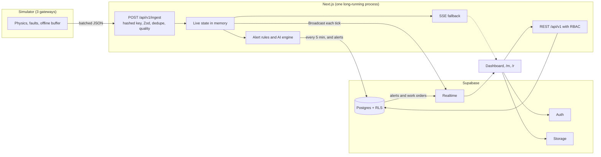

# SUNPULSE — Build Plan

Status: **confirmed on the rebrand-and-reshape path (§9, option A) for the 7 November pitch.** The local database stays until after the pitch, so §2, §3 and §7 describe the later Supabase stage. See README.md for the current state.
Checked on 2026-11-05 against the npm registry, Supabase docs, the Supabase project and this machine.

---

## 1. Decisions needed before Phase 1

Reply "go" to accept the defaults, but **D1 needs a real answer**.

| # | Decision | Default | Why it matters |
|---|---|---|---|
| D1 | **Competition date.** Is this still the 7 November pitch? | None, please tell me | If it is, a full rewrite in 2 days carries real risk. I'd use the cut line in §9 and keep the earlier version as the fallback. |
| D2 | Where SUNPULSE lives | New branch `sunpulse`, with `main` tagged and left alone until SUNPULSE is demo-ready | Keeps a working demo available at all times. Renaming the GitHub repo is your call. |
| D3 | Does anyone need a public URL? | No. Run locally with `next start` and Supabase in the cloud | Live state and the simulator need a long-running process. A public URL needs an always-on host, and the demo logins would have to come off the login page. |
| D4 | Supabase region | Please check it in the dashboard | The database host looks like it's in Sydney (from its IPv6 prefix, not confirmed), and auth calls took about 0.6–0.9 s from here. Singapore would be better. The region can't be changed in place, but this project is empty, so now is the cheapest time to move. |
| D5 | Number of gateways | **Keep 3** | One gateway could cover 30 houses, but it would be a single point of failure. With 3, one zone can go offline while the rest stays live, which also makes a better demo. |
| D6 | Battery sharing | Each pair of houses uses its own battery first. Surplus then moves to other batteries over a cluster bus, and PLN connects at cluster level | The spec says both "serves its 2 houses" and "shared PV surplus". This reading satisfies both and gives a clean energy balance. |

### What only you can do

Do these in the dashboard and `.env.local`. Don't paste secrets into chat.

1. **Turn off public sign-ups before seeding (Auth settings).** They're on now, so anyone with the public key can create an account. The app won't grant a role to accounts it didn't seed, but closing this is simple.
2. **Set `DIRECT_URL` to the Session pooler (port 5432), not the direct host.** I confirmed the direct host has only an IPv6 address and this Mac has no IPv6 route, so migrations would fail. Copy the host from the Connect dialog.
3. Set `DATABASE_URL` to the Transaction pooler (port 6543), and fill in `SUPABASE_SECRET_KEY`.
4. **Free up disk space.** About 6 GB is free, down from 13 GB yesterday. I don't know what used it, as this project accounts for only about 1.4 GB.

---

## 2. Changes to the spec (rule 6)

### Won't work as written

| Spec says | Problem | Proposal |
|---|---|---|
| `DIRECT_URL` on the direct connection, port 5432 | IPv6-only on the free plan (checked above) | Session pooler, as in §1. |
| RLS protects every role | **Prisma connects as a database owner and bypasses RLS**, so RLS doesn't protect the API routes | Two separate layers: RBAC checks in code on every route, and RLS on every table for anything the browser reaches with the public key. Tests cover both. |
| Live telemetry over Supabase Realtime | Supabase's benchmarks show Postgres Changes is much slower with RLS, because each change is checked for each subscriber. They suggest re-streaming through Broadcast | **Telemetry:** one Broadcast snapshot per 5 s tick on a private staff channel. **Alerts and work orders:** Postgres Changes, as they're low volume. **SSE:** kept as the fallback. |
| Live updates for residents | 30 per-house channels would use about 518,000 of the 2 million free monthly messages per day | The resident view polls an RBAC-filtered API every 5 s. |
| Latest values in memory | Doesn't work on serverless | Fine for D3's default. A hosted version would need an always-on server. |

### Conflicts inside the spec

| Conflict | Resolution |
|---|---|
| The payload example puts H21 on GW-2, but 10 houses per gateway puts H21 on GW-3 | GW-1 = H01–H10, GW-2 = H11–H20, GW-3 = H21–H30. The example gets corrected. |
| SoH range of 72–99% vs. a default state with only 4 issues. Anything under 80% raises its own alert | Start at 82–99%. The "Fast-forward 30 days" scenario pushes a battery under 80%, which shows the threshold working. |
| Dual-axis SoC/SoH chart | Both are percentages, so one axis is enough. Dual scales imply correlations that aren't there. |
| "`.env.example`: placeholders only" vs. a block with real values | `.env.example` gets placeholders. Real values go in `.env.local`. The publishable key is designed to be public, but **this repo is public**, so nothing else gets committed. |
| "Use exactly these names", yet gateway keys need a secret | No new variable. The seed generates the keys, stores hashes, and writes plaintext to a git-ignored file for the simulator. |
| Partial shading in the default state, but a clock locked at 10:15 could fall outside the shaded hours | Shading runs 09:30–11:00, so it's visible at 10:15. |

### Additions

- **Keep the lockable clock.** It isn't in this spec, but an evening pitch would otherwise show 0 kW. Time Travel doesn't replace it: "now" still has to be daytime.
- **Time Travel covers the dashboard only** (sun arc, energy flow, KPIs, mini map), with a clear "Menampilkan pukul 14.30" banner. Other pages stay live, because replaying 12 pages is a lot of work for little visible gain. Future times use the forecast and are labeled as estimates.
- **Library pins:**
  - Prisma **7.10.1** (`latest` is still `8.0.0-rc.30`)
  - TanStack Table **v8**, which the existing tables already use
  - `motion` rather than the `framer-motion` package
  - no GSAP or Lottie unless the hero needs them
- **Placeholder coordinates:** the spec's values are in central Jakarta, so 30 houses would land on high-rises. The env values stay as you specified, but the map opens on the schematic view first. A residential location would look better if you have one.

---

## 3. Architecture



- **Keep pages fast despite remote latency.** Live values come from memory, and history is cached for short periods, so pages don't wait on several round trips to the database.
- **Don't call Auth on every request.** The proxy verifies the JWT locally with `getClaims` where possible, since each Auth call took 0.6–0.9 s here.
- **Roles live in the JWT** (`app_metadata`: role, house ID), set by the seed with the secret key. RLS policies read the JWT, which avoids recursive lookups on `profiles`.
- **Secret key check:** a build step fails if `SUPABASE_SECRET_KEY` appears in the client bundle.

### Metering boundaries

| Meter | Location | Measures |
|---|---|---|
| M1 | Each house, inverter AC output | PV production |
| M2 | Each house, load panel | House load |
| M3 | Each battery | Charge and discharge |
| M4 | Cluster, PLN connection | PLN import |

Balance, with a required unit test: `PV + PLN_import + Battery_discharge = Load + Battery_charge + Curtail + Losses`.

**No export credit** stays the default, as agreed earlier, and becomes a Settings toggle here.

### Sizing

Scaled from the mix tuned for the earlier version, so batteries are still charging at 10:15.

| Item | Assumption | Result |
|---|---|---|
| PV | 30 systems, 1.1–3.3 kWp | About 57 kWp, 270 kWh/day |
| Load | 30 houses, about 7 kWh/day each | About 210 kWh/day |
| Battery | 15 × 51.2 V 200 Ah LiFePO₄ | About 154 kWh |

### Data volume

91 telemetry sources (30 PV, 15 batteries, 46 meters):

| Dataset | Rows |
|---|---|
| 5-minute, 48 h | About 52,000 |
| Hourly, 30 days | About 66,000 |
| Live writes | About 26,000 per day, pruned by the retention job |

This should fit comfortably in 500 MB. I'll measure actual size and seed time over the network in Phase 2.

---

## 4. Reuse from the earlier version

The old alley concept was removed from the code, and a check script fails the build if the word reappears. It still exists in git history.

| Area | Plan |
|---|---|
| Physics, fault models, simulator | Keep, adapting topology and dispatch |
| AI engine, alert rules, tests | Keep. Peer comparison now covers the whole cluster |
| Ingest, dedupe, offline buffer, demo scenarios | Keep. Add 2 scenarios: cloudy day and fast-forward |
| Map, charts, tables, energy flow, sun arc | Keep and restyle |
| Data layer | **Rewrite:** Postgres, migrations, RLS |
| Auth | **Rewrite:** Supabase Auth |
| Visual design | **Redo:** the "Solar Pulse" design system |
| All other pages | New, or rebuilt around the new topology |

---

## 5. Roles

| Capability | DLH | Admin Klaster | Teknisi | Warga |
|---|---|---|---|---|
| Monitoring pages | All | All | All, read-only | Own house and its battery |
| Owner names | Yes | Yes | Owner code only | Own only |
| AI diagnosis | Yes | Yes | Yes | No |
| Alerts | Handle | Handle | Handle | See own issues |
| Work orders | Create, assign, verify | Create, assign, verify | Update assigned | Report a fault |
| Reports | Yes | Yes | Maintenance only | No |
| Devices | Manage | Manage | View | No |
| Users | Manage | View | No | No |
| Settings | Manage | Most, not API keys or backup | No | No |
| Demo controller | Yes | Yes | No | No |

**Privacy:** a battery is shared by 2 houses, so a Warga sees its status but nothing about the neighbor's consumption or name.

---

## 6. Design system

The spec sets the palette, fonts, dark-first theme and bento layout, so I'll follow those.

- **Signature element:** the Pulse Score ring with its heartbeat line, plus the isometric cluster on the landing page.
- **Restraint:** the spec lists many effects at once. To keep it from feeling like a template, aurora appears only on the landing hero and dashboard header, glows only on hero and KPI cards, and everything else stays quiet.
- **Status:** always icon + label + color, with the same 5 states everywhere.
- **Charts:** I'll re-run the palette validator for the new colors in both themes, because amber, coral and red can collide with the status colors.
- **Motion:** transform and opacity only, paused when the tab is hidden, off under reduced motion.
- **Review:** screenshots in both themes at the end of each phase.

---

## 7. Phases

Each ends with lint, typecheck, build and a browser check with no console errors, then a stop for your review.

### Phase 1: Foundation
- [ ] Branch and tag, rename, remove the old grouping concept, automated check
- [ ] Solar Pulse tokens, dark and light themes, ID/EN, app shell, command palette
- [ ] Supabase Auth, RBAC, 4 demo accounts
- [ ] Landing and login page with the isometric cluster

**Done when:** each role logs in and sees the correct menus.
**Note:** demo accounts need `SUPABASE_SECRET_KEY`, so I'll ask for `.env.local` at the start of this phase, not Phase 2 as the spec says.

### Phase 2: Data and IoT
- [ ] Prisma schema on Supabase, `supabase/policies.sql`, RLS tests per role
- [ ] Geo generator, 30-day seed, adapted simulator, default demo state
- [ ] `/ingest` with hashed keys, quality pipeline, Broadcast and SSE, retention job

**Done when:** `npm run seed` and `npm run simulate` show live data in the UI, with seed size and time measured.

### Phase 3: Core monitoring
- [ ] Dashboard with Pulse Score, Time Travel and Sun Arc
- [ ] Web-GIS, House & Solar, Battery Health, Hybrid Energy, Alert Center, Users

**Done when:** every page shows live data, filters work, and the map is smooth.

### Phase 4: Intelligence
- [ ] 4 AI tabs, predictive risk, 24-hour forecast, Ask SUNPULSE
- [ ] Maintenance: kanban, calendar, photos, verification, effectiveness evaluation
- [ ] Technician `/m` and resident `/r`

**Done when:** each injected fault gives the correct detection, diagnosis, alert and recommended work order.

### Phase 5: Advanced and polish
- [ ] Reports (PDF, Excel), IoT & Devices, Settings, audit log, backup/restore
- [ ] Full Demo Controller, PWA, animation polish, responsive QA, docs, tests

**Done when:** the demo script runs end to end from a fresh clone and all tests pass. Lighthouse will be reported as measured.

---

## 8. Risks

| # | Risk | Mitigation |
|---|---|---|
| R1 | **The demo now depends on the internet.** The earlier version ran fully offline, but login and history now need Supabase, and Docker isn't installed for a local copy | Test on a phone hotspot beforehand, record a backup video, and keep the earlier version available as an offline fallback |
| R2 | **Free projects pause after 1 week of inactivity** | Open the project the day before, and run the fresh-clone check that morning |
| R3 | Realtime fails or is slow at the venue | Automatic switch to SSE, with the live indicator showing which is in use |
| R4 | Message quota (2 million per month). At a 5 s tick with 2 viewers, about 52,000 per day | Run the simulator only when needed, and show usage in system health |
| R5 | Re-seeding daily over the network is slower than local SQLite | Batch inserts, and measure in Phase 2 |
| R6 | Lighthouse ≥ 90 with aurora, isometric art, a map and charts | Lazy-load them, and report real numbers without tuning the test |
| R7 | Laptop limits: 8 GB RAM, about 6 GB free disk | Free up space first (§1) |
| R8 | **Scope.** Bigger than the earlier version: 2 mobile views, reports, 2 languages, RLS, 5 more pages | Build in order, keep each phase demo-ready, and use §9 if needed |

---

## 9. Cut line

Applies if D1 is close. Cut from the top down:

1. PWA install, Isolation Forest, satellite basemap, sound and haptics
2. Backup/restore, system health widget, calendar view
3. Excel export, then PDF beyond one report type
4. English on secondary pages (Indonesian stays complete)
5. Users CRUD (seeded accounts stay), asset registry editing in Settings
6. Resident view `/r`, photo upload

**Never cut:** landing page, dashboard with Pulse Score, map, one full fault-to-verification loop, Demo Controller, AI disclaimers, RLS on every table.

**If the pitch really is on 7 November**, my recommendation is one of these:

- **A. Rebrand and reshape:** SUNPULSE name and visual design, the 30-house topology, and the local database. Supabase comes after the pitch. Realistic in 2 days.
- **B. Full Supabase rebuild with the cut list.** Doable, but it adds the internet dependency and leaves less time for rehearsal.

I'd choose **A** for a 7 November pitch, and the full plan if there's more time.

---

## 10. Commands

```
npm install && npm run db:setup && npm run dev   # terminal 1
npm run simulate                                 # terminal 2
npm run demo                                     # or both at once
```
