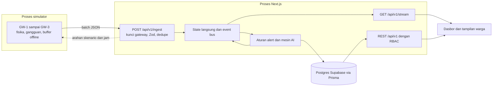

# SUNPULSE

**Denyut energi klaster permukiman Anda.**

Sistem Manajemen Energi Hibrida PLTS-Baterai-PLN berbasis AIoT dengan Fault Detection and Diagnosis, Predictive Maintenance, dan Battery Health Management pada klaster permukiman. Prototipe lomba dengan **data simulasi**.

Satu klaster: 30 rumah dengan PV atap, 15 baterai bersama (1 baterai melayani 2 rumah bertetangga), dan 3 gateway IoT.

## Menjalankan

Membutuhkan Node.js 24.

Data disimpan di Postgres Supabase, sehingga aplikasi **membutuhkan internet**. Login tetap memakai NextAuth.

```bash
nvm use
npm install
node scripts/ensure-env.mjs   # membuat .env, lalu berhenti sampai URL database diisi
```

Isi `.env`, yang tidak pernah masuk git:

| Variabel | Sumber |
|---|---|
| `DATABASE_URL` | Connect di dashboard Supabase, Transaction pooler, port 6543 |
| `DIRECT_URL` | Connect di dashboard Supabase, Session pooler, port 5432 |
| `NEXT_PUBLIC_SUPABASE_URL`, `NEXT_PUBLIC_SUPABASE_PUBLISHABLE_KEY` | Hanya untuk `npm run db:verify-rls` |

Karakter khusus pada password harus di-percent-encode. Unduh juga sertifikat CA dari Database settings > SSL Configuration, lalu simpan sebagai `supabase-ca.crt` di root project. Tanpa file itu, koneksi ditolak, karena sertifikat server selalu diverifikasi.

```bash
npm run db:setup       # skema, RLS, dan data awal
npm run demo           # aplikasi dan simulator
npm run db:verify-rls  # di terminal kedua, saat aplikasi berjalan
```

Buka http://localhost:3000. `npm run demo` memperbarui skema, menyusun ulang data bila berasal dari hari lain, lalu menjalankan aplikasi dan simulator.

Untuk pengembangan: `npm run dev`, dan `npm run simulate` di terminal kedua.

### Keamanan database

- `prisma/enable-rls.sql` mengaktifkan RLS di semua tabel setelah setiap `db push`. Tanpa policy, Data API Supabase tidak mengembalikan baris apa pun, sementara Prisma tetap punya akses sebagai pemilik tabel.
- `npm run db:verify-rls` membuktikan REST dengan publishable key tidak mengembalikan data dan login aplikasi tetap berhasil.
- Project free tier berhenti setelah 1 minggu tanpa aktivitas, jadi buka dashboard sebelum presentasi.

## Akun demo

Kata sandi semua akun: `demo1234`

| Email | Peran | Akses |
|---|---|---|
| `dlh@sunpulse.id` | Super Admin DLH | Seluruh data dan kontrol demo |
| `admin@sunpulse.id` | Admin Klaster | Pengelolaan klaster dan kontrol demo |
| `teknisi1@sunpulse.id` | Teknisi | Pemantauan, alert, dan pekerjaan, tanpa nama pemilik |
| `warga.h01@sunpulse.id` | Warga | Hanya rumah H01 dan status baterainya |

Tekan **Shift+D** untuk kontrol demo. Naskah presentasi ada di [docs/demo-script.md](docs/demo-script.md).

## Arsitektur



- **Satu proses berjalan lama.** State langsung dan SSE ada di memori, sehingga aplikasi tidak berjalan pada serverless sebagaimana adanya.
- **Simulator memakai jalur sebenarnya.** Gangguan melewati ingest, deteksi, dan alert yang sama dengan data gateway.
- **Pembagian energi.** Tiap pasangan rumah memakai bateranya lebih dulu. Sisanya berpindah lewat bus klaster, dan PLN menutup kekurangan.
- **Waktu simulasi.** `SIM_CLOCK_MODE=locked` mengunci jam di `SIM_CLOCK_LOCK_AT` (bawaan 10.15 WIB) agar produksi surya terlihat kapan pun presentasi berlangsung.

Kontrak telemetri ada di [docs/iot-contract.md](docs/iot-contract.md).

## Mesin AI

Statistik dan aturan yang dapat dijelaskan, bukan model terlatih:

- **Deteksi anomali:** residual terhadap ekspektasi, z-score robust, perbandingan dengan seluruh rumah di klaster, dan ambang fisik.
- **Analisis akar masalah:** skor bergaya Bayes dengan bukti untuk tiap penyebab.
- **Prediksi SoH:** regresi linear dengan rentang keyakinan.
- **Skor kesehatan dan Pulse Score:** bobot tetap dengan rincian faktor.

Keluaran selalu diberi label estimasi dan perlu diverifikasi teknisi. Pengujian memakai gangguan dari simulator sendiri, sehingga membuktikan alur kerja, bukan akurasi lapangan.

## Asumsi

- Koordinat adalah placeholder. Ubah `NEXT_PUBLIC_MAP_CENTER_LAT` dan `NEXT_PUBLIC_MAP_CENTER_LNG` di `.env`, lalu jalankan `npm run seed`. Tata letak rumah tetap hasil generator.
- Tidak ada kredit ekspor PLN, sehingga surplus PV dicatat sebagai curtail. Nilai ini ditetapkan dalam kode dan dilabeli di layar.
- Tarif PLN (`PLN_TARIFF_RP`) dan faktor emisi (`GRID_EMISSION_FACTOR`) adalah estimasi yang perlu dikonfirmasi ke sumber resmi.
- Satu baterai 51,2 V 200 Ah (10,24 kWh) LiFePO₄.

## Pengujian

```bash
npm test
npm run typecheck
npm run lint
```

Pengujian mencakup skor kesehatan, Pulse Score, topologi, penutupan neraca energi, dan deteksi setiap jenis gangguan yang disuntikkan.
