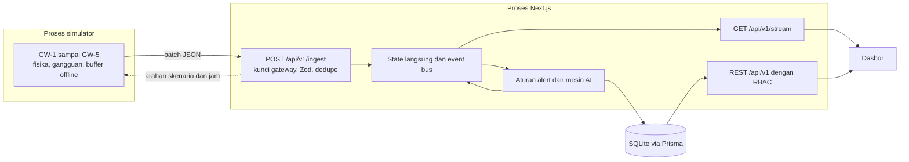

# DOCTOR PV

Community Energy Management System berbasis AIoT untuk satu RT: 5 gang, 100 rumah dengan PV atap, 50 baterai bersama, dan 5 gateway IoT. Prototipe hackathon dengan **data simulasi**.

Alur intinya: pantau, analisis dengan AI, tindak lanjuti, lalu evaluasi.

## Menjalankan

Membutuhkan Node.js 24 (`nvm use`).

```bash
npm install
npm run demo
```

Buka http://localhost:3000. `npm run demo` menyiapkan `.env` dan database, menyusun ulang data bila berasal dari hari lain, lalu menjalankan aplikasi dan simulator.

Untuk pengembangan: `npm run db:setup`, `npm run dev`, dan `npm run simulate` di terminal kedua.

## Akun demo

Kata sandi semua akun: `demo1234`

| Email | Peran | Akses |
|---|---|---|
| `dlh@doctorpv.id` | Super Admin DLH | Seluruh data dan kontrol demo |
| `admin.rt@doctorpv.id` | Admin RT | Seluruh gang dan kontrol demo |
| `gang1@doctorpv.id` | Koordinator Gang | Hanya Gang 1 |
| `teknisi1@doctorpv.id` | Teknisi | Pemantauan dan penanganan alert, tanpa nama pemilik |

Tekan **Shift+D** untuk kontrol demo. Naskah presentasi ada di [docs/demo-script.md](docs/demo-script.md).

## Arsitektur



- **Satu proses berjalan lama.** State langsung dan SSE ada di memori, sehingga aplikasi tidak berjalan pada serverless sebagaimana adanya. Produksi multi-instance membutuhkan Postgres dan broker seperti MQTT atau Redis.
- **Simulator memakai jalur sebenarnya.** Gangguan melewati ingest, deteksi, dan alert yang sama dengan data gateway.
- **Waktu simulasi.** `SIM_CLOCK_MODE=locked` mengunci jam di `SIM_CLOCK_LOCK_AT` (bawaan 10.15 WIB) agar produksi surya terlihat kapan pun presentasi berlangsung.

Kontrak telemetri ada di [docs/iot-contract.md](docs/iot-contract.md).

## Mesin AI

Statistik dan aturan yang dapat dijelaskan, bukan model terlatih:

- **Deteksi anomali:** residual terhadap ekspektasi, z-score robust, perbandingan dengan aset sekitar, dan ambang fisik.
- **Analisis akar masalah:** skor bergaya Bayes dengan bukti untuk tiap penyebab.
- **Prediksi SoH:** regresi linear dengan rentang keyakinan.
- **Skor kesehatan:** bobot tetap dengan rincian faktor.

Keluaran selalu diberi label estimasi dan perlu diverifikasi teknisi. Pengujian memakai gangguan dari simulator sendiri, sehingga membuktikan alur kerja, bukan akurasi lapangan.

## Asumsi

- Koordinat adalah placeholder. Ubah `NEXT_PUBLIC_MAP_CENTER_LAT` dan `NEXT_PUBLIC_MAP_CENTER_LNG` di `.env`, lalu jalankan `npm run seed`. Tata letak rumah tetap hasil generator.
- Tidak ada kredit ekspor PLN, sehingga surplus PV dicatat sebagai curtail. Nilai ini ditetapkan dalam kode dan dilabeli di layar.
- Tarif PLN (`PLN_TARIFF_RP`) dan faktor emisi (`GRID_EMISSION_FACTOR`) adalah estimasi yang perlu dikonfirmasi ke sumber resmi.
- Satu baterai 51,2 V 200 Ah (10,24 kWh) LiFePO₄. Ukuran dipilih agar pola energi masuk akal.

## Pengujian

```bash
npm test
npm run typecheck
npm run lint
```

Pengujian mencakup skor kesehatan dan deteksi setiap jenis gangguan yang disuntikkan.
